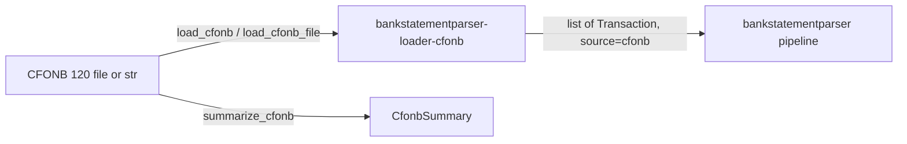

<!-- SPDX-License-Identifier: Apache-2.0 OR MIT -->

<p align="center">
  
</p>

<h1 align="center">bankstatementparser-loader-cfonb</h1>

<p align="center">
  French CFONB 120 (AFB120) bank statement loader that parses fixed-width 120-character statements into bankstatementparser Transaction objects.
</p>

<p align="center">
  <a href="https://github.com/sebastienrousseau/bankstatementparser-loader-cfonb/actions"></a>
  <a href="https://pypi.org/project/bankstatementparser-loader-cfonb/"></a>
  <a href="https://sebastienrousseau.com/bankstatementparser-loader-cfonb/"></a>
  <a href="https://scorecard.dev/viewer/?uri=github.com/sebastienrousseau/bankstatementparser-loader-cfonb"></a>
  <a href="LICENSE"></a>
  <a href="https://github.com/sebastienrousseau/bankstatementparser-loader-cfonb/blob/main/docs/POLICIES.md"></a>
</p>

<p align="center">
  
</p>

---

## Contents

**Getting started**

- [Install](#install): PyPI, source
- [Requirements](#requirements): toolchain floor, platforms
- [Quick Start](#quick-start): parse a statement in three lines

**The bankstatementparser-loader-cfonb ecosystem**

- [The bankstatementparser-loader-cfonb ecosystem](#the-bankstatementparser-loader-cfonb-ecosystem): the core library, the other loaders and writers

**Library reference**

- [Capabilities at a glance](#capabilities-at-a-glance): the current surface by theme
- [Ecosystem comparison](#ecosystem-comparison): short matrix; full table at [`docs/COMPARISON.md`](docs/COMPARISON.md)
- [Benchmarks](#benchmarks): headline numbers; full table at [`docs/BENCHMARKS.md`](docs/BENCHMARKS.md)
- [Features](#features): public API, record layout, amounts and signs
- [Configuration](#configuration): core options
- [Examples](#examples): runnable example index

**Operational**

- [When not to use bankstatementparser-loader-cfonb](#when-not-to-use-bankstatementparser-loader-cfonb): limitations
- [Development](#development): make targets, fuzzing, CI
- [Security](#security): guarantees and compliance
- [Documentation](#documentation): all reference docs
- [Stability guarantees](#stability-guarantees): SemVer axis, output stability, minimum toolchain discipline
- [License](#license)

---

## Install

### As a Python library

```bash
pip install bankstatementparser-loader-cfonb
```

That installs the loader and `bankstatementparser >= 0.0.35`, which brings `pandas` and `pydantic`.

| Channel | Command | Notes |
| :--- | :--- | :--- |
| PyPI | `pip install bankstatementparser-loader-cfonb` | Pulls in `bankstatementparser >= 0.0.35` |
| Source | `git clone https://github.com/sebastienrousseau/bankstatementparser-loader-cfonb && cd bankstatementparser-loader-cfonb && poetry install` | For development |

Verify the installation:

```sh
python -c "import bankstatementparser_loader_cfonb as b; print(b.__version__)"
# -> 0.0.37
```

An isolated virtual environment keeps the loader's dependencies apart:

```sh
python -m venv venv
source venv/bin/activate        # macOS/Linux
venv\Scripts\activate           # Windows
python -m pip install -U bankstatementparser-loader-cfonb
```

---

## Requirements

- **Python 3.10 or later.** CI tests CPython 3.10, 3.11, 3.12, 3.13 and 3.14 on Linux, macOS and Windows; [`docs/POLICIES.md`](docs/POLICIES.md) says when the floor moves.
- **[`bankstatementparser`](https://pypi.org/project/bankstatementparser/) 0.0.35 or later**, whose `Transaction` model and `BankStatementParser` base class the loader produces and extends.
- No network access, native extensions or system packages of its own.

---

## Quick Start

```python
from bankstatementparser_loader_cfonb import load_cfonb_file

for txn in load_cfonb_file("statement.cfonb"):
    print(txn.booking_date, txn.amount, txn.currency, txn.description)
```

Or parse an in-memory payload:

```python
from bankstatementparser_loader_cfonb import load_cfonb

payload = "\n".join(
    [
        "0110057012319000EUR2 00012345678  010126" + " " * 50 + "0000000150000{",
        "0410057012319000EUR2 0001234567802050126  050126"
        "VIREMENT RECU CLIENT ACME        REF1234  0000000025000{",
        "0410057012319000EUR2 0001234567803100126  100126"
        "PRELEVEMENT EDF ELECTRICITE      REF5678  0000000004500K",
        "0710057012319000EUR2 00012345678  310126" + " " * 50 + "0000000170499H",
    ]
)

for txn in load_cfonb(payload):
    print(txn.booking_date, txn.amount, txn.category, txn.description)
# 2026-01-05 2500.00 cfonb:02 VIREMENT RECU CLIENT ACME
# 2026-01-10 -450.02 cfonb:03 PRELEVEMENT EDF ELECTRICITE
```

Both return a flat `list` of `bankstatementparser.transaction_models.Transaction` objects with `source="cfonb"`, ready for the rest of a `bankstatementparser` pipeline. The last character of each amount is its units digit and sign: `{` is +0, `K` is -2.

---

## The bankstatementparser-loader-cfonb ecosystem

bankstatementparser-loader-cfonb is one of the input loaders of the `bankstatementparser` suite, whose packages ship one version together. The full table is in [The suite](docs/suite.md).

| Component | Purpose | Use case |
| :--- | :--- | :--- |
| [`bankstatementparser`](https://github.com/sebastienrousseau/bankstatementparser) | The parser core: CAMT, pain.001, CSV, OFX, QFX, MT940, MT942, BAI2 and PDF statements, and the `Transaction` model | Parsing statements from Python or the CLI |
| **`bankstatementparser-loader-cfonb`** | This loader: CFONB 120 text to `Transaction` objects, with overpunched amounts decoded and `05` details appended | Loading statements from French banks |
| Other loaders | BAI2, MT942, CAMT.054, SEPA pain.002 / pain.008 and BACS Standard 18 | Formats beyond the core |
| Writers and transport | XLSX, QIF, OFX and SWIFT writers; EBICS retrieval | Exporting transactions and fetching statements |
| [`bankstatementparser-mcp`](https://github.com/sebastienrousseau/bankstatementparser-mcp), [`bankstatementparser-lsp`](https://github.com/sebastienrousseau/bankstatementparser-lsp) | Agent tools and editor diagnostics over the core | AI agents and MT940 editing |



---

## Capabilities at a glance

| Area | Capability | Status |
| :--- | :--- | :--- |
| Loading | `load_cfonb` (text or lines) and `load_cfonb_file` (path) to `list[Transaction]` | Shipped |
| Summary | `summarize_cfonb` to a `CfonbSummary` (account, bank, branch, currency, opening and closing balances and dates, count, credit and debit totals) without building transactions | Shipped |
| Core integration | `CfonbStatementParser`, a `BankStatementParser` registered as `cfonb` and `afb120` in `bankstatementparser.loaders` | Shipped |
| Records | `01`, `04`, `05` (text appended to the operation) and `07`; other lines skipped | Shipped |
| Robustness | CRLF, blank, short and unknown lines, unparsable dates and stray characters in amounts never raise | Shipped |
| Multiple accounts | Several `01`...`07` blocks in one file load as one list; the summary keeps the last header's fields | Partial |
| `05` qualifiers | Parsing `LIB`, `RUM`, `NPY` and other qualifiers into fields | Not in this loader |
| Writing | Producing CFONB 120 files | Not in this loader |

---

## Ecosystem comparison

The core `bankstatementparser` reads no CFONB. [`python-cfonb`](https://github.com/dhatim/python-cfonb) reads and writes it, with the same column layout. Every cell comes from the projects' own source code.

| Project | Output | Malformed line | Writes CFONB |
| :--- | :---: | :---: | :---: |
| **bankstatementparser-loader-cfonb** | `Transaction` objects | Skipped | No |
| `python-cfonb` 2.13 (LGPL) | `Statement` rows per account | Raises `ParsingError` | Yes |
| `bankstatementparser` 0.0.35 | No CFONB | Not applicable | No |

See [`docs/COMPARISON.md`](docs/COMPARISON.md) for the evidence and complete matrix.

---

## Benchmarks

`benches/bench_load_cfonb.py` times `load_cfonb` and `summarize_cfonb` on CFONB 120 statements of 10 to 50,000 operations, every other one with a `05` detail.

Cost per operation rises only 1.09x from 10 to 50,000 operations, and a summary costs at most 0.87x a full load.

| Scenario | Result | Environment |
| :--- | ---: | :--- |
| `load_cfonb`, 1,000 operations (178 KiB) | 10.50 ms | Apple M1 Pro, macOS 27.2.1, CPython 3.12.16 |
| `load_cfonb`, 50,000 operations (8.7 MiB) | 633.81 ms | Apple M1 Pro, macOS 27.2.1, CPython 3.12.16 |
| `summarize_cfonb`, 50,000 operations (8.7 MiB) | 492.49 ms | Apple M1 Pro, macOS 27.2.1, CPython 3.12.16 |

See [`docs/BENCHMARKS.md`](docs/BENCHMARKS.md) for methodology and full results.

---

## Features

<!-- --8<-- [start:features] -->

### Public API

```python
from bankstatementparser_loader_cfonb import (
    CfonbStatementParser,
    CfonbSummary,
    load_cfonb,
    load_cfonb_file,
    summarize_cfonb,
)
```

| Class / Function | Signature | Returns |
| :--- | :--- | :--- |
| `load_cfonb` | `load_cfonb(text_or_lines)`: a `str` or an iterable of lines | `list[Transaction]` |
| `load_cfonb_file` | `load_cfonb_file(path)`: a `str` or `os.PathLike` | `list[Transaction]` |
| `summarize_cfonb` | `summarize_cfonb(text_or_lines)`: a `str` or an iterable of lines | `CfonbSummary` |
| `CfonbStatementParser` | `CfonbStatementParser(file_name)` | `BankStatementParser` with `parse()` (DataFrame), `to_transactions()` and `get_summary()` (dict) |

`CfonbSummary` is a frozen dataclass with the fields `account_id`, `bank_code`, `branch_code`, `currency`, `opening_balance`, `closing_balance` (`Decimal` or `None`), `opening_date`, `closing_date`, `transaction_count`, `total_credit` and `total_debit` (both positive `Decimal`s).

### Record layout

Every record is 120 characters and starts with its code: `01` (ancien solde, the opening balance), `04` (an operation), `05` (complementary detail of the preceding operation) or `07` (nouveau solde, the closing balance). The loader reads these columns (1-based, inclusive); `tests/test_docs_accuracy.py` checks every row of this table against the parser:

| Columns | Field Name | Records | Description |
| :--- | :--- | :--- | :--- |
| `3-7` | Bank Code | 01, 04 | Code banque |
| `8-11` | Internal Operation Code | 04 | Not read |
| `12-16` | Branch Code | 01, 04 | Code guichet |
| `17-19` | Currency | 01, 04 | ISO 4217 code; `EUR` when blank |
| `20` | Number Of Decimals | 01 | Scale of every amount; 2 when blank |
| `22-32` | Account Number | 01, 04 | The transaction's `account_id` |
| `33-34` | Interbank Operation Code | 04 | Kept as `category` `cfonb:<code>` |
| `35-40` | Date | 01, 04, 07 | `JJMMAA`: the balance date, or the operation (booking) date |
| `43-48` | Value Date | 04 | `JJMMAA`; the operation date when blank |
| `49-79` | Label | 04 | Libellé, the start of the description |
| `82-88` | Entry Number | 04 | Numéro d'écriture, kept as `reference` |
| `91-104` | Amount | 01, 04, 07 | 13 digits and a signed units character, see below |
| `49-118` | Complementary Information | 05 | Appended to the operation's description |

On `04` records a blank bank, branch, currency or account takes the `01` header's value.

### Mapping to `Transaction`

| `Transaction` field | Source |
| :--- | :--- |
| `account_id` | Account number (22-32) |
| `currency` | Currency (17-19), else the header's, else `EUR` |
| `amount` | The decoded amount, signed |
| `booking_date`, `value_date` | Operation date (35-40); value date (43-48), else the operation date |
| `description` | The label, then each `05` record's text, space-separated |
| `reference` | The entry number (82-88), or `None` when blank |
| `category` | `cfonb:<interbank code>`, or `None` when blank |
| `source`, `source_index` | `"cfonb"` and the operation's position in the file |

### Amount and sign convention

An amount zone (91-104) is 13 digits and a final character that carries both the units digit and the sign. The digits are divided by `10 ** decimals` (column 20 of the `01` header) as a `decimal.Decimal`, never a `float`.

| Final character | Units digit | Sign |
| :--- | :--- | :--- |
| `{` `A` `B` `C` `D` `E` `F` `G` `H` `I` | 0 to 9 | **positive** (credit) |
| `}` `J` `K` `L` `M` `N` `O` `P` `Q` `R` | 0 to 9 | **negative** (debit) |
| `0`-`9` | itself | positive |

So `0000000001904}` with 2 decimals is -190.40. Characters other than ASCII digits elsewhere in the zone are skipped, and an empty zone is 0.

### Errors

None of the functions raises on malformed CFONB text: a line that is not a record is skipped, a date that does not parse is `None` (a value date falls back to the operation date), and an amount keeps its ASCII digits. `load_cfonb_file` raises `OSError` when the file cannot be read; undecodable bytes are replaced, not refused.

<!-- --8<-- [end:features] -->

---

## Configuration

The loader has no options, configuration file or environment variables: the record layout and the sign convention above are fixed, so the same file always loads the same way. Installing the package registers `CfonbStatementParser` under the `cfonb` and `afb120` names in the `bankstatementparser.loaders` entry-point group, which is how the core discovers it; nothing needs to be configured for that.

---

## Examples

[`examples/`](examples/) holds two runnable scripts, each run in CI against an inline sample, so no data files are needed:

| Example | Demonstrates |
| :--- | :--- |
| [`01_basic_usage.py`](examples/01_basic_usage.py) | `load_cfonb` and `summarize_cfonb` on a statement built at the standard's columns |
| [`02_advanced_workflow.py`](examples/02_advanced_workflow.py) | `CfonbStatementParser` reading the statement from disk as a DataFrame and a summary, and reconciling the balances |

```sh
python examples/01_basic_usage.py
```

---

## When not to use bankstatementparser-loader-cfonb

- **You need to write CFONB.** This loader only reads; `python-cfonb` also writes statements and transfers.
- **You need the `05` qualifiers as fields.** The loader appends each `05` record's text to the description; it does not split out the debtor, the mandate reference (`RUM`) or other qualified data.
- **You need several accounts kept apart.** Operations from every `01`...`07` block load into one list (each keeps its own `account_id`), and the summary describes the last header and closing balance only.
- **You want malformed input refused.** The loader is lenient by design: it skips what it cannot read rather than raising.
- **You have CFONB 240 or the 160-character transfer formats.** This loader reads the 120-character statement layout only.

---

## Development

```bash
git clone https://github.com/sebastienrousseau/bankstatementparser-loader-cfonb.git
cd bankstatementparser-loader-cfonb
poetry install
make check
```

`make check` runs the local gates: `ruff` lint and format, `mypy --strict`, the complexity baseline (`scripts/check_complexity.py`), `bandit`, `pytest` with a 100% line + branch coverage floor, `interrogate` at 100% docstring coverage, and the examples. Other targets: `make fuzz` (Atheris, 60 s, Linux x86_64 with Python 3.12+), `make bench`, `make audit` (`pip-audit` on every locked set), `make docs` (the MkDocs manual, `--strict`) and `make demo` (re-renders the GIF above with VHS from `.github/demo.tape`). CI adds the OS by Python matrix, the fuzz run, CodeQL, `pip-audit` and the Docs Lint gates. [`CONTRIBUTING.md`](CONTRIBUTING.md) covers branches and commit signing.

---

## Security

- **Read-only.** The loader only reads text and files you pass it; it writes nothing.
- **No XML, no network, no code execution.** Parsing is fixed-column string slicing into dataclasses.
- **Decimal arithmetic** for every amount, and only ASCII digits count as digits, so a stray character cannot become part of a number.
- **Fuzzing.** `fuzz/fuzz_load_cfonb.py` drives `load_cfonb` and `summarize_cfonb` with Atheris in CI, seeded with the repository's fixtures, and fails on any exception, any malformed `Transaction` and any disagreement between the load and the summary.
- **Supply chain.** Dependencies are locked in `poetry.lock`, CI installs hash-pinned exports of it, and `pip-audit` and CodeQL run on every change. Releases publish to PyPI through OIDC trusted publishing and carry cosign signatures, SLSA provenance and SBOMs; every workflow action is pinned by commit SHA except the SLSA generator, which must be referenced by tag.

Report vulnerabilities according to [`SECURITY.md`](SECURITY.md).

---

## Documentation

- **User manual:** [sebastienrousseau.com/bankstatementparser-loader-cfonb](https://sebastienrousseau.com/bankstatementparser-loader-cfonb/), built from [`docs/`](docs/) with MkDocs
- **API reference:** [the manual's API page](https://sebastienrousseau.com/bankstatementparser-loader-cfonb/api/), generated from the docstrings
- **Developer docs:** [`CONTRIBUTING.md`](CONTRIBUTING.md), [`ARCHITECTURE.md`](ARCHITECTURE.md)
- **The suite:** [`docs/suite.md`](docs/suite.md), with every `bankstatementparser` package
- **History:** [`CHANGELOG.md`](CHANGELOG.md)
- **Project site:** [bankstatementparser.com](https://bankstatementparser.com)

---

## Stability guarantees

- **Versioning.** Releases stay on the `0.0.x` line and step by exactly `0.0.1`, in lockstep with the rest of the `bankstatementparser` suite. Under SemVer a `0.0.x` release may break anything; this project names each break in the CHANGELOG instead, as 0.0.36 does for the move to the standard's columns.
- **The breaking axis is the output**: which lines produce a `Transaction`, the value and sign of each amount, and how each `Transaction` field is filled. Changing any of them for a file that loaded before is a breaking change and is called out in the CHANGELOG, even when no Python signature moves.
- **Output stability.** The loader is deterministic: the same payload gives the same transactions in the same order.
- **Python API.** `load_cfonb`, `load_cfonb_file`, `summarize_cfonb`, `CfonbSummary` and `CfonbStatementParser` keep their names and fields; names starting with `_` are internal.
- **Minimum toolchain.** Python 3.10 is the floor; it moves only in a release, for the whole suite at once, with the reason in the CHANGELOG ([`docs/POLICIES.md`](docs/POLICIES.md)).

---

## License

Dual-licensed under [Apache License, Version 2.0](LICENSE-APACHE) or [MIT](LICENSE-MIT), at your option (`SPDX-License-Identifier: Apache-2.0 OR MIT`). Built on the core [`bankstatementparser`](https://github.com/sebastienrousseau/bankstatementparser) library. Any contribution submitted for inclusion in the work shall be dual-licensed as above, without additional terms or conditions.
